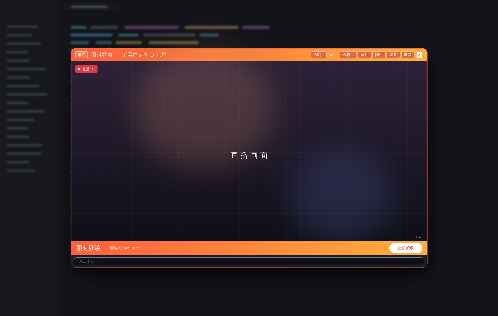
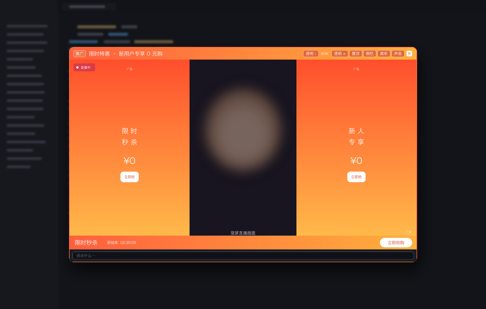
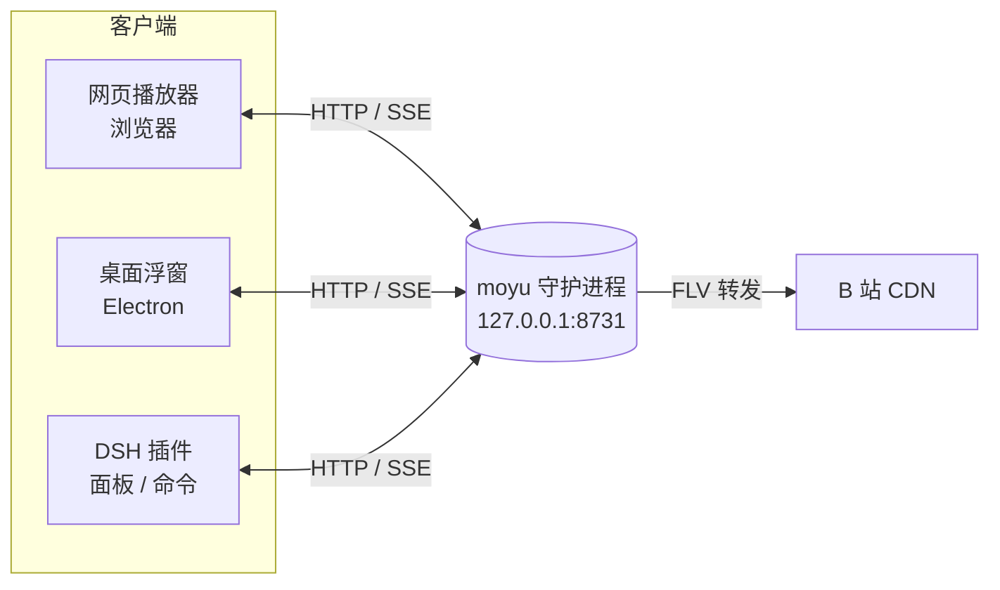

<div align="center">

# 🐟 moyu-live

**把 B 站直播塞进你的工作流。**

置顶小窗 · 随手发弹幕 · 伪装成推广弹窗 · 一键黑听

[](https://github.com/EricZzzzz221b/moyu-live/releases)
[](#-快速开始)
[](./LICENSE)
[](#-从源码运行)



<sub>窗口浮在代码编辑器上面，看起来就像一条关不掉的推广广告 :)</sub>

</div>

---

## 为什么会有这个

上班的时候想瞄两眼直播，但每次都要在「浏览器标签页 → 直播间 → 找输入框 → 打弹幕」之间来回切，切一次心虚一次。

所以做了这个：直播画面变成一个**永远置顶、可以调透明度、点得到后面代码**的小窗，外观伪装成推广弹窗；想发弹幕按 `⌘D` 弹个输入框就行，不用回网页。

## ✨ 功能

| | 能力 | 说明 |
|---|---|---|
| 🪟 | **恒置顶浮窗** | 无边框小窗浮在所有应用之上，可拖动、可调透明度 |
| 🖱️ | **鼠标穿透** | 只有顶栏和输入栏接收点击，中间画面直接点到后面的编辑器 |
| ⌨️ | **`⌘D` 随手发弹幕** | 任何应用前台都能唤出输入框，回车即发 |
| 🎧 | **黑听模式** | 窗口收起、只留声音，`⌘D` 照样能发弹幕 |
| 🥷 | **广告伪装** | 橙色「推广」条 + 秒杀倒计时 + `广告` 标识，`×` 关掉即退出 |
| 📢 | **侧栏广告** | 竖屏直播时，两侧黑边填成动态广告（字号呼吸、扫光、闪烁） |
| ⚡ | **低延迟** | FLV 本地转发，1 秒级，接近网页；HLS 自动兜底 |
| 🔌 | **DSH 插件**（可选） | 在 DeepSeek Harness 里 `/zhibo` 起直播、`/dm` 发弹幕 |

<details>
<summary>📢 竖屏直播的侧栏广告长这样（点开看）</summary>



两侧黑边会填满动态广告，宽度永远等于黑边宽度，画面一点不挡。
</details>

## 🚀 快速开始

### Windows

1. 去 [Releases](https://github.com/EricZzzzz221b/moyu-live/releases) 下载 `moyu-live-*-win.zip`
2. 解压，双击 `moyu-live.exe`
3. 托盘图标右键 → **导入登录态（从 Chrome）**

守护进程已内置，**不需要另外安装 Node**。

### macOS

```bash
git clone https://github.com/EricZzzzz221b/moyu-live.git
cd moyu-live

# 1. 导入登录态（从 Chrome 读 cookie，只写本地，不上传）
cd moyu && node bin/auth.mjs

# 2. 起服务（房间号或直播间链接都行）
node bin/moyu.mjs play 161574 --no-open

# 3. 起浮窗
cd ../moyu-desktop && npm install && ./run.sh
```

浏览器打开 `http://127.0.0.1:8731/` 也能直接看（网页版，不用装 Electron）。

### （可选）装进 DeepSeek Harness

用 DSH 的插件管理器安装 `moyu-dsh/`，然后：

```text
/zhibo 161574                                   起直播 / 换台
/zhibo https://live.bilibili.com/161574?...     直接粘整条链接
/dm 这波操作可以                                  在输入框里直接发弹幕，不进对话
```

## ⌨️ 热键

| 热键 | 动作 |
|---|---|
| `⌘D` / `Ctrl+D` | 发弹幕输入框（黑听时也能用，不会把画面拉出来） |
| `⌘⇧D` / `Ctrl+Shift+D` | 黑听 / 显示画面 |
| `⌘⇧[` `⌘⇧]` | 调透明度 |
| `⌘⇧T` | 切换「始终置顶」 |
| `⌘⇧A` | 侧栏广告开关 |

## 🧱 结构



三个客户端共用同一个守护进程：登录态、播放地址、弹幕通道都只有一份。

## 🔬 一些实现细节

做过才知道的坑，都写在代码注释里：

- **FLV 不能直连**：CDN 看到浏览器带的 `Origin` 会返回 403，所以由本地服务带 `Referer` 转发；换来的是 1 秒级延迟（HLS 要 6~8 秒）
- **弹幕 WS 的 uid 必须是 0**：传真实 uid 又不带 cookie，服务端会静默回 0 个包，看起来像"账号被风控"
- **`code: 0` 不代表发出去了**：房间有发言限制时会静默吞弹幕，只能靠回显核对
- **昵称会被打码**（`埃***`），认人一律用 uid
- **`getDanmuInfo` 会 -352 风控**，收弹幕走老端点 `room/v1/Danmu/getConf`
- **透明窗口的穿透**：macOS 上 Electron 的 `forward` 不生效，最后用屏幕坐标轮询判断鼠标在不在顶栏/输入栏

## ❓ FAQ

**画面比网页慢？**
看画面左下角的角标：`FLV 缓冲 0.x s` 就说明链路已经到底了，剩下的是 B 站编码端的 GOP（约 2 秒），没有更低的公开通道。

**发出去没反应？**
可能被吞了。房间的发言等级限制、账号风控都会让接口返回成功但消息不显示。

**Windows 上打不开 / 白屏？**
先确认托盘图标有没有出现；`%APPDATA%\moyu-live-desktop\` 下没有 `.cookie.json` 的话，点托盘里的「导入登录态」。

**会不会封号？**
只发你亲手输入的内容，没有定时、没有刷屏、没有自动化。但接口调用本身有风控风险，自己权衡。

## 🗺️ Roadmap

- [ ] macOS 签名安装包（现在要源码跑）
- [ ] 多直播间收藏与一键切换
- [ ] 弹幕关键词高亮 / 屏蔽
- [ ] 纯音频流（服务端 ffmpeg 抽音轨，真·省流量）

## ⚠️ 免责声明

本项目仅供**个人学习与自用**。请遵守 B 站用户协议及当地法律法规；因使用本工具造成的账号异常、数据丢失等后果由使用者自行承担。

## 📄 License

[MIT](./LICENSE) · 第三方组件见 [THIRD-PARTY.md](./THIRD-PARTY.md)
